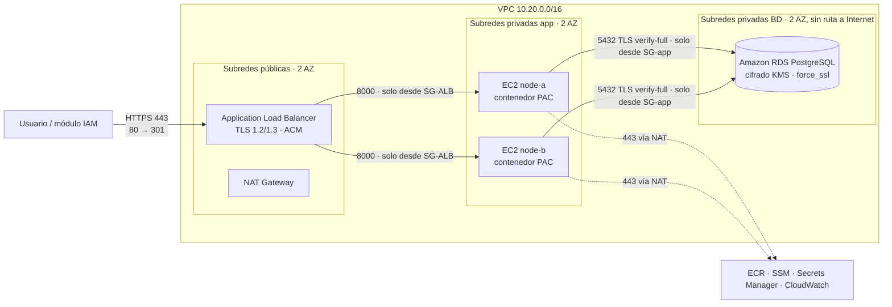

# MediNet-Core · Módulo PAC (Pacientes y Admisión) — EVA03

Grupo 6 · Desarrollo Seguro (CI3064) · INACAP Temuco

Backend FastAPI del módulo PAC evolucionado a **alta disponibilidad Multi-AZ en AWS**, aprovisionado 100 % con **Terraform**, detrás de un **ALB con FQDN y TLS válido**, con **Amazon RDS privado y cifrado**, autorización **JWT**, cabeceras de seguridad, auditoría y pipeline con escaneo **IaC (Checkov)**, **SAST (Bandit)** y **SCA (Trivy)**.

## Arquitectura



| Requisito de la pauta | Dónde está |
|---|---|
| IaC 100 % declarativa (VPC, 2 AZ, rutas, IGW/NAT, SG, ALB, EC2, RDS) | `infra/*.tf` |
| Sin credenciales en el repositorio | Contraseña maestra RDS gestionada por AWS (Secrets Manager); API y JWT en SSM SecureString con KMS; `.gitignore` |
| AWS Academy (LabRole / LabInstanceProfile) | variable `aws_academy = true` |
| Escaneo IaC en CI/CD | job `iac-scan` (Checkov + `terraform validate`) en `.github/workflows/ci-cd.yml` |
| ALB en 2 AZ con health checks | `infra/alb_dns.tf` (`/health` cada 5 s) + apagado ordenado `pac-drain` en `infra/user_data.sh.tftpl` |
| FQDN + certificado válido, 80 → 443 | ACM + Route 53 en `infra/alb_dns.tf`; política `ELBSecurityPolicy-TLS13-1-2-2021-06` |
| Swagger solo bajo HTTPS | `https://<FQDN>/docs` |
| 2 EC2 en AZ distintas, contenedor endurecido | `infra/compute.tf`, `Dockerfile`, `infra/user_data.sh.tftpl` |
| SG chaining | `infra/security_groups.tf` |
| RDS privado, cifrado, subnet group Multi-AZ, SG solo desde backend | `infra/data.tf` |
| TLS en tránsito y cifrado en reposo | ALB TLS 1.2/1.3 · `rds.force_ssl=1` + `sslmode=verify-full` · KMS en RDS/EBS/SSM/logs/ECR |
| Sin stack traces, datos enmascarados en logs | `app/main.py`, `app/audit.py` |
| HSTS, nosniff, X-Frame-Options, CSP, CORS restrictivo | `app/main.py` |
| JWT | `app/security.py` (HS256, iss/aud/exp, roles `pac:read` / `pac:write`) |
| Concurrencia ACID entre nodos | `UNIQUE(run)` + `SELECT … FOR UPDATE` en PATCH; probado con 40 altas simultáneas |
| Eventos de auditoría | JSON a CloudWatch Logs (`/medinet-pac/app`), RUN enmascarado |
| DAST (OWASP ZAP) | `tools/zap_scan.ps1` |
| Failover | `tools/failover.py` |
| Ataque controlado | `tools/attack.py` |

## Estructura

```
app/                  Backend FastAPI (PAC + seguridad EVA03)
migrations/           Alembic
scripts/containers/   entrypoint y preparación de BD (migración + rol mínimo, con advisory lock)
tests/                pytest contra PostgreSQL desechable
infra/                Terraform (AWS Multi-AZ)
tools/                token de demo, ataque controlado, failover, OWASP ZAP
.github/workflows/    CI/CD
```

## Probar en local (Windows)

```powershell
python -m venv $env:USERPROFILE\.pacvenv          # ruta corta: evita el límite de 260 caracteres
& $env:USERPROFILE\.pacvenv\Scripts\Activate.ps1
pip install -r requirements-dev.txt
docker run -d --name pac-test-db -e POSTGRES_DB=pac_test -e POSTGRES_USER=pac_test_admin `
  -e POSTGRES_PASSWORD=solo-pruebas-locales -p 127.0.0.1:55434:5432 postgres:17-alpine
python -m pytest -q        # 21 passed
```

---

## Guía de despliegue en AWS (paso a paso)

> **Costo.** Lo que más cobra es el **NAT Gateway (~1,1 USD/día)**, el **ALB (~0,6 USD/día)** y **RDS (~0,4 USD/día)**: en total unos **2,5 USD por día** encendido. Despliega, haz las pruebas y ejecuta `terraform destroy` el mismo día.

### 0. Herramientas
- Terraform ≥ 1.6, AWS CLI v2, Docker Desktop, Python 3.11+.
- Sesión de AWS: en cuenta propia `aws configure`; en AWS Academy copia las credenciales de *AWS Details* a `%USERPROFILE%\.aws\credentials`.

### 1. Dominio gratuito (FQDN)
1. Crea un dominio gratis que permita **cambiar los servidores DNS (NS)**, por ejemplo en DigitalPlat FreeDomain (`.dpdns.org`) o en un registrador similar.
2. Elige el nombre del servicio, por ejemplo `pac.grupo6medinet.dpdns.org`.

### 2. Configurar Terraform
```powershell
cd infra
copy terraform.tfvars.example terraform.tfvars
notepad terraform.tfvars     # domain_name, region, aws_academy, github_repository
terraform init
```
> **Cuenta con plan gratuito de AWS:** agrega `db_backup_retention_days = 1` en `terraform.tfvars`. Ese plan rechaza más de 1 día de respaldo en RDS (`FreeTierRestrictionError`).

### 3. Crear la zona DNS y delegarla
```powershell
terraform apply -target=aws_route53_zone.main
terraform output name_servers
```
Copia los **4 servidores NS** en el panel del dominio gratuito. La propagación puede tardar desde minutos hasta unas horas; verifica con:
```powershell
nslookup -type=NS pac.TU-DOMINIO 8.8.8.8
```
> **Al volver a desplegar** después de un `terraform destroy`, Route 53 crea una zona nueva con **otros 4 servidores NS**. Hay que reemplazarlos en el panel del dominio (en DigitalPlat: dominio → DNS → *Servidores de nombres*) antes del paso 4, o el certificado no se valida.

### 4. Desplegar toda la infraestructura
```powershell
terraform apply
```
Tarda unos 15 minutos (RDS y la validación del certificado son lo más lento). Al final muestra `url`, `swagger`, `ecr_repository_url` y `github_deploy_role_arn`.

### 5. Publicar la imagen (primera vez)
**Opción A: GitHub Actions.** En el repositorio, ve a *Settings → Secrets and variables → Actions* y configura:
- Variables: `DEPLOY_ENABLED = true` y `AWS_REGION`.
- Si usas cuenta propia, agrega la variable `AWS_ROLE_ARN` con el valor de `github_deploy_role_arn`.
- Si usas AWS Academy, agrega los secretos `AWS_ACCESS_KEY_ID`, `AWS_SECRET_ACCESS_KEY` y `AWS_SESSION_TOKEN`. Esa sesión caduca cada 4 horas, así que hay que actualizarla.

Después haz `git push` a `main`. El pipeline prueba, escanea, publica la imagen en ECR y despliega **nodo por nodo**.

**Opción B: manual**
```powershell
$REPO = terraform output -raw ecr_repository_url
aws ecr get-login-password | docker login --username AWS --password-stdin $REPO.Split("/")[0]
docker build -t "${REPO}:v1" ..
docker push "${REPO}:v1"
aws ssm put-parameter --name /medinet-pac/app/image_tag --type SecureString --overwrite --value v1
aws ssm send-command --document-name AWS-RunShellScript --targets Key=tag:Role,Values=pac-backend `
  --parameters 'commands=["/usr/local/bin/pac-deploy"]'
```

### 6. Verificar
```powershell
curl.exe -I http://pac.TU-DOMINIO/health        # 301 → https
curl.exe -i https://pac.TU-DOMINIO/health       # 200 + HSTS, X-Frame-Options...
python ..\tools\dev_token.py                    # token JWT de demo (lee el secreto de SSM)
```
Abre `https://pac.TU-DOMINIO/docs`, presiona **Authorize** y pega el token.

### 7. Evidencias para la rúbrica
```powershell
$T = python tools\dev_token.py
$R = python tools\dev_token.py --roles pac:read

# Ataque controlado (carrera, inyección, XSS, tokens, roles)
python tools\attack.py https://pac.TU-DOMINIO --token $T --readonly-token $R

# Failover: déjalo corriendo y detén una EC2 en la consola (Estado → Detener)
python tools\failover.py https://pac.TU-DOMINIO --token $T

# DAST con OWASP ZAP (reportes en evidence\)
$env:PAC_TOKEN = $T; .\tools\zap_scan.ps1 -Url https://pac.TU-DOMINIO
```
Los reportes de Checkov, Bandit y Trivy quedan como *artifacts* en cada ejecución del pipeline.

Para ver los eventos de auditoría: **CloudWatch → Log groups → `/medinet-pac/app`**.

### 8. Administrar sin SSH
Las EC2 no tienen IP pública ni puerto 22. Para entrar, usa **EC2 → Connect → Session Manager**, o desde la terminal:
```powershell
aws ssm start-session --target <instance-id>
```

### 9. Apagar todo (no gastar saldo)
```powershell
cd infra
terraform destroy
```
Revisa después en la consola que no queden instancias, NAT Gateway, ALB ni RDS. La llave KMS queda programada para borrarse en 7 días, y eso no tiene costo extra.

### Despliegue realizado (16-11-2026)
Se desplegó en `us-east-2` sobre `https://medinetpacg6.dpdns.org`, se tomaron todas las evidencias (`docs/evidencias/aws/`) y luego se ejecutó `terraform destroy` (70 recursos eliminados). Resultados: certificado ACM válido con TLS 1.3, ZAP 120/0/0, ataque 13/13 bloqueado (carrera repartida 25/25 entre nodos y 1 fila en RDS) y failover con 96,98 % de disponibilidad (unos 5 s de errores 502).

Se volvió a desplegar el mismo día con el apagado ordenado (`pac-drain`: el nodo sale del target group antes de detenerse) y el health check cada 5 s: el failover dio **100 % (81/81, sin errores)**. Las fotos de las pruebas son capturas reales de PowerShell y de la consola de AWS (`docs/evidencias/capturas/` y `docs/evidencias/capturas_aws/`), tomadas con `tools/capturas_locales.ps1` y `tools/capturas_aws.ps1`.

## Decisiones y omisiones justificadas
- **WAF, Enhanced Monitoring, RDS standby Multi-AZ y DNSSEC** quedan fuera por costo o por restricciones de AWS Academy. Cada uno está justificado en `.checkov.yaml` o en comentarios `checkov:skip` dentro del código. `db_multi_az = true` activa la réplica standby de RDS.
- **Un solo NAT Gateway**: si cae la AZ a, ambos nodos siguen sirviendo tráfico (el ALB y RDS no dependen del NAT). Solo se pierde la salida a Internet para despliegues hasta que se recupere.
- **JWT HS256 con secreto compartido** con el módulo IAM, guardado en SSM con KMS. El paso natural siguiente sería RS256 con JWKS publicado por IAM.
- **Hallazgo corregido gracias al ataque controlado**: el sistema aceptaba `<script>` en nombres (XSS almacenado para quien renderice esos datos). Ahora se rechazan `<` y `>` en nombres, apellidos y dirección.
